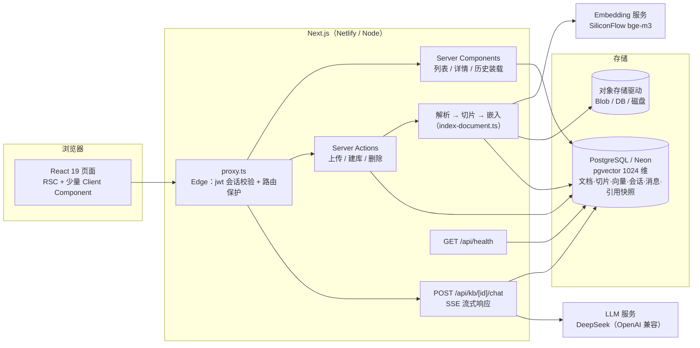

# knowledge-base

个人知识库问答（RAG）应用：上传文档 → 解析切片 → 向量化入库 → 基于检索的流式问答，回答带引用溯源，可回溯任意历史会话。

**线上演示**：https://afei-knowledge-base.netlify.app （GitHub 账号登录即可试用）
**部署与运维手册**：[`docs/DEPLOY.md`](docs/DEPLOY.md) ｜ **评测记录**：[`eval/RESULTS.md`](eval/RESULTS.md)

技术栈：Next.js 16（App Router）· React 19 · TypeScript · Tailwind CSS 4 · NextAuth v5 · Prisma 7 · PostgreSQL（pgvector）· Netlify

---

## 功能

- **用户系统**：GitHub OAuth 登录，数据按用户隔离；`proxy.ts`（Next 16 起 middleware 更名）做路由保护
- **知识库管理**：多知识库 CRUD，创建 / 重命名 / 删除
- **文档上传与解析**：PDF / Markdown / TXT，单文件 ≤ 4MB；解析 → 切片 → 嵌入的异步状态机（pending → processing → ready / failed），失败原因可见，可一键重建索引
- **RAG 问答**：pgvector 余弦检索 TOP_K=5 → DeepSeek 流式生成，首字约 0.6s；答案标注引用来源，点开可见**当时**真正喂给模型的片段全文
- **会话历史**：多会话分组，URL 携带会话 id（刷新 / 后退 / 分享链接均不丢）；支持删除（消息级联清理）
- **可运维**：`/api/health` 健康检查（DB 连通 + 版本 + 延迟）、全局错误边界、部署验收清单与故障档案

## 快速开始

```bash
git clone https://github.com/233zhangwen/knowledge-base.git
cd knowledge-base
npm install

# 准备 .env.local（变量清单见 docs/DEPLOY.md 第三节）
cp .env.example .env.local   # 若无此文件，按 DEPLOY.md 手工配置

npx prisma migrate dev       # 建表（含 pgvector 扩展）
npm run dev                  # 已封装代理注入，见 ADR-6
```

依赖一个 Postgres（需装 pgvector 扩展）、一个 OpenAI 兼容的 Embedding 服务、一个 OpenAI 兼容的 LLM 服务、GitHub OAuth 应用。完整清单与获取方式见 [`docs/DEPLOY.md`](docs/DEPLOY.md)。

## 架构



**一条问答的完整路径**：问题 → 嵌入成向量 → 在**本知识库内**（`kbId` + `status='ready'` 过滤）按余弦距离取 TOP_K=5 片段 → 与最近 3 轮历史、system 规则拼装 → LLM 流式生成 → 服务端读上游 SSE、边读边转发，**引用快照作为流的第一行**先到达前端 → 生成完成后答案 + 快照落库。

关键参数（均有评测或推理依据，见下文）：

| 参数 | 值 | 位置 |
|---|---|---|
| 切片 | 目标 500 字 / 重叠 80 | `src/lib/chunk.ts` |
| 向量 | bge-m3，1024 维，cosine | `src/lib/embedding.ts` |
| 召回 | TOP_K = 5 | `src/lib/retrieve.ts` |
| 上下文历史 | 最近 3 轮（6 条），不带旧引用 | `src/lib/llm.ts` |
| 采样 | temperature = 0（线上与评测同源读取） | `src/lib/rag-prompt.json` |

## 评测

不凭感觉调参。W6 建了一套 25 条的评测集（覆盖 12 个章节 / 9 个切片，含改述与跨片段计算 case），脚本三档：

```bash
node scripts/eval.mjs --check      # 校验评测集指纹与配置对齐（防标注漂移）
node scripts/eval.mjs              # 检索层：recall@1 / @3 / @5
node scripts/eval.mjs --with-llm   # 答案层：检索 + 逐条调用 LLM 比对关键词
```

**基线（2026-10-26）**：recall@1 = 0.740，recall@3 = 0.960，recall@5 = 1.000（9 块的库 @5 已饱和，调优看 @1/@3）；答案层关键词命中 25/25。

两轮调优（完整记录见 [`eval/RESULTS.md`](eval/RESULTS.md)）：

1. **TOP_K 5→3 → 回滚**。三指标纹丝不动，但答案层 25/25 → 24/25：期望块掉出 LLM 上下文。教训：*只盯检索指标会漏掉一半真相，检索层管"在不在候选里"，答案层管"LLM 有没有拿到能用它的上下文"。*
2. **prompt v1→v2（禁 markdown）→ 保留**。先用对照轮（同温度、去规则）证明星号 3→0 归因于 prompt 而非采样参数，再保留。教训：*先固定测量（temperature=0 且线上/评测同源），再改变量，否则分不清功劳。*

评测方法本身也迭代了 18 版（V1~V18 全程记录在 `docs/ACCEPTANCE-W6.md`），抓到 5 个自己写的 bug，其中最典型的两条：

- **判据精度不能超过测量精度**：远程 embedding 同输入两次的浮点尾数会抖动，"逐字节一致"是过强判据，改为"排序序列 + 指标一致"，排序键先归并到测量噪声以下；
- **模拟线上的评测路径，每处取数都要问"线上这里取几条"**：`--with-llm` 曾把 5 条全喂给 LLM 而线上只喂 K 条，K=3 出现"指标全绿、实际变差"的假象，做反证才暴露。

## 设计决策（ADR）

### 1. session 策略用 jwt，不用 database
`proxy.ts` 跑在 Edge Runtime，**没有 Prisma**。database 策略下 cookie 里放的是 Session 表的随机 token，读 session 必须查库——proxy 做不到，会报 `JWEInvalid` 把所有已登录用户弹回登录页。选 jwt 后 cookie 本身就是加密会话，proxy 本地解密零数据库依赖。代价：**服务端无法主动吊销某个设备的会话**（MVP 接受）。

### 2. NextAuth 配置拆成两份（split config）
- `src/auth.config.ts`：Edge 安全，只有 providers / pages / session 策略 / authorized 回调，**不 import Prisma**
- `src/auth.ts`：展开上面那份 + `PrismaAdapter`（Node Runtime）

坑：合并时 `callbacks` 必须写 `...authConfig.callbacks` 再追加——对象展开遇同名 key 是**覆盖不是合并**，漏了这行 `authorized` 就没了，路由保护**静默失效**（不报错、不告警）。

### 3. LLM 调用用原生 fetch，不装 AI SDK
W4 需要的只有两件事：流式吐字、透传非标准参数 `thinking`（DeepSeek 是推理模型，必须显式关闭思考，`enable_thinking: false` 实测无效）。AI SDK 的 streamText / useChat / tool-calling MVP 全用不上，而 `thinking` 这类非标准字段走 `providerOptions` 透传有被 provider 层吞掉的风险。原生 fetch + SSE 解析一共 60 行，全部在自己手里——**"provider 可替换"靠接口边界实现，不靠装库**：换服务商只动 `llm.ts` 一个文件。

### 4. AI provider 走 OpenAI 兼容抽象
无海外账号，用国内服务：Embedding 用 SiliconFlow `BAAI/bge-m3`（1024 维），LLM 用 DeepSeek。代码层统一 OpenAI 兼容协议指向各自 baseURL，保留切换能力。

### 5. Prisma 7 的连接地址不在 schema 里
Prisma 7 起 `schema.prisma` 不再支持 `url` / `directUrl`，改到根目录 `prisma7.config.ts`。该 config 没有 `directUrl` 字段，所以分两处：迁移用 `DIRECT_URL`（直连），运行时用 `DATABASE_URL`（连接池）。

### 6. 本地开发需要给 Node 挂代理
浏览器走系统代理，但 **Node 的内置 fetch 不认 Windows 系统代理**，服务端拿 code 换 access_token 时直连 github.com 超时。解法：由外层进程设 `NODE_USE_ENV_PROXY=1` + `HTTPS_PROXY` 再启动 next dev（**必须在进程启动前设**，运行时改 `process.env` 无效），已封装成 `npm run dev`。

### 7. 上传的原件存对象存储，且与问答链路解耦
先问"留着原件是为了什么"：重新切片、用户下载、引用溯源——而**引用溯源不需要原件**（切片文本已在 Chunk 表）。排除两个错误答案：服务器本地磁盘（serverless 文件系统只读/临时）、存 Postgres bytea（免费层额度小、拖慢查询）。选对象存储 + **驱动抽象**：

```
BLOB_READ_WRITE_TOKEN 有 → Vercel Blob
否则 STORAGE_DRIVER=db   → Postgres BYTEA（Netlify 生产实际在用的驱动）
否则                     → 本地磁盘 .storage/（开发）
```

落地约定：Server Action 内上传（才能集中校验大小/MIME/归属）、key 含 userId 天然隔离、仅 PDF/MD/TXT、单文件 4MB（三层上限对齐：应用 4MB → Next bodySizeLimit 5MB → 平台 4.5MB，依据可查，不是拍脑袋）。

**关键设计：问答只读 Postgres，一次都不碰对象存储。** 存储挂了问答功能完全不受影响，只是不能下载原件。

**PDF 解析选 unpdf 且刻意动态 import**：pdfjs bundle 1.5MB，`await import('unpdf')` 让传 1KB 的 .md 不加载它（`next build` 产物确认落在独立懒加载 chunk）。

### 8. 对话历史：存快照、不存外键
历史回答里的引用存**当时的片段全文**（Message.citations），不存 chunkId 外键。否则重建索引后翻旧对话，看到的是重排过的、甚至不存在的切片——同一个 bug 只是推迟三个月发作。副作用（是特性）：删掉文档后，历史引用仍显示当时原文，忠实记录"这个答案是依据当时那份文档得出的"。

配套三条：会话 id 搭流的第一行回前端（不为拿 id 多一次往返）；「停止生成」落库标记 stopped、「生成失败」不落库（防止假回答污染数据）；切换会话靠 key 重挂载清状态。

## 踩坑实录（部署侧精选）

完整档案（F1~F8）在 [`docs/DEPLOY.md`](docs/DEPLOY.md)，这里挑三条跨平台通用的：

- **secrets scanning 误报**：平台把构建产物里的字符串反查环境变量值，模型名、API 地址全被当密钥拦下。用审计脚本确认真密钥零命中后，按 key 白名单豁免。
- **serverless 文件系统只读**：本地开发"上传后写 `.storage/`"一切正常，上线后 `ENOENT: /var/task/.storage`。这正是驱动抽象存在的意义——加一个 db 驱动即修复，业务代码零改动。
- **未配置部署域名时 OAuth 404**：NextAuth 会用部署预览域名拼回调地址，而预览域名默认是私有的。`AUTH_URL` 必须显式指向正式域名。

## 项目结构

```
src/
├── app/
│   ├── kb/                    # 知识库列表 / 详情页（RSC + Client 组件）
│   │   └── [id]/              # 上传、文档列表、问答面板、会话侧栏
│   ├── api/
│   │   ├── health/            # 健康检查
│   │   └── kb/[id]/chat/      # SSE 流式问答
│   ├── login/                 # 登录页
│   ├── error.tsx / not-found.tsx
│   └── page.tsx               # 根路径 → /kb
├── proxy.ts                   # 路由保护（Next 16 的 middleware，Edge）
├── auth.config.ts / auth.ts   # NextAuth 拆分配置（ADR-2）
└── lib/
    ├── parse.ts               # unpdf 动态导入（ADR-7）
    ├── chunk.ts               # 500/80 切片
    ├── embedding.ts           # bge-m3 / 1024 维
    ├── retrieve.ts            # pgvector 余弦检索，TOP_K
    ├── llm.ts                 # 原生 fetch SSE（ADR-3）
    ├── rag-prompt.json        # prompt 单一来源（线上与评测同源）
    ├── chat-protocol.ts       # 流协议：首行快照 + 增量文本 + 错误帧
    ├── history.ts             # 会话/消息装载，数据边界校验
    └── storage.ts             # 三驱动对象存储（ADR-7）
eval/cases.json                # 25 条评测集（带内容指纹）
scripts/eval.mjs               # 评测脚本（--check / 默认 / --with-llm）
docs/                          # 各周验收 spec + 部署手册
```

## Out of Scope（显式不做）

团队协作与共享、在线文档编辑、外部数据源同步（网页/飞书/Notion）、Agent 式 query 改写与多轮工具调用、计费配额、移动端原生适配、rerank 精排（已留接口位置）、大文件直传（签名 URL 方案）。

这些不是没想到，是**评估后决定不进 MVP**——每一条展开都会显著增加攻击面或复杂度，而当前的核心命题是把 RAG 主链路和评测方法做扎实。

## 路线图

- [x] W1 项目骨架 + 用户系统（GitHub OAuth + 路由保护）
- [x] W2 知识库 CRUD + 文档上传解析（PDF/MD/TXT）
- [x] W3 切片 + 嵌入 + 索引状态机
- [x] W4 RAG 检索问答（pgvector + 流式）
- [x] W5 会话历史 + 引用溯源
- [x] W6 评测集 + 基线 + 两轮调优
- [x] W7 部署上线（Netlify）+ 健康检查 + 运维手册
- [x] W8 完整 README + 演示录屏
