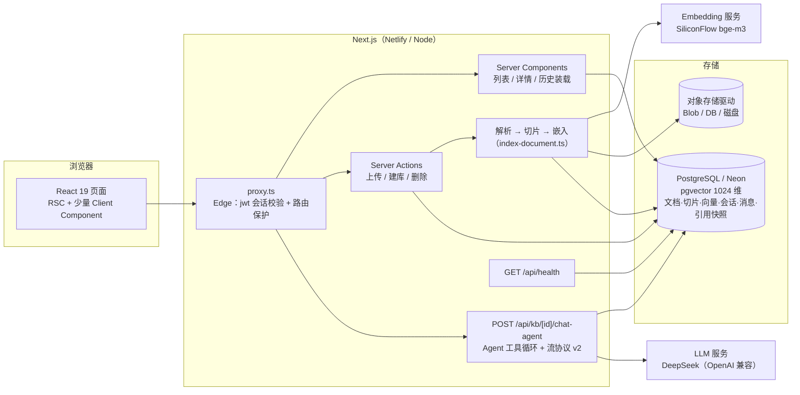

# knowledge-base

[](https://github.com/233zhangwen/knowledge-base/actions/workflows/ci.yml)

个人知识库问答应用：上传文档 → 解析切片 → 向量化入库 → **Agent 化问答**——由模型决定何时检索（闲聊零检索）、把模糊问题改写成检索问句、需要时多步调用工具，回答带引用溯源，可回溯任意历史会话。

**线上演示**：https://afei-knowledge-base.netlify.app （GitHub 账号登录即可试用）
**部署与运维手册**：[`docs/DEPLOY.md`](docs/DEPLOY.md) ｜ **评测记录**：[`eval/RESULTS.md`](eval/RESULTS.md)

技术栈：Next.js 16（App Router）· React 19 · TypeScript · Tailwind CSS 4 · NextAuth v5 · Prisma 7 · PostgreSQL（pgvector）· Netlify

---

## 功能

- **用户系统**：GitHub OAuth 登录，数据按用户隔离；`proxy.ts`（Next 16 起 middleware 更名）做路由保护
- **知识库管理**：多知识库 CRUD，创建 / 重命名 / 删除
- **文档上传与解析**：PDF / Markdown / TXT，单文件 ≤ 4MB；解析 → 切片 → 嵌入的异步状态机（pending → processing → ready / failed），失败原因可见，可一键重建索引
- **Agent 化问答**（W10 起）：检索作为**工具**交给模型——它自己决定查不查（闲聊零 embedding 开销）、把指代不清的问题改写成独立检索问句（"那病假呢" → 完整问句）、必要时多步检索（评测集中观察到自发二次检索）；工具失败时自发重试并体面收场（说明原因、拒绝凭记忆编造）
- **流式与引用溯源**：答案流式输出，检索完成即推送引用事件；答案标注引用来源，点开可见**当时**真正喂给模型的片段全文；引用编号跨多步全局一致
- **会话历史**：多会话分组，URL 携带会话 id（刷新 / 后退 / 分享链接均不丢）；支持删除（消息级联清理）
- **可运维**：`/api/health` 健康检查（DB 连通 + 版本 + 延迟）、全局错误边界、部署验收清单与故障档案

## 快速开始

```bash
git clone https://github.com/233zhangwen/knowledge-base.git
cd knowledge-base
npm install

# 准备 .env.local（变量清单见 docs/DEPLOY.md 第三节）
cp .env.example .env.local   # 若无此文件，按 DEPLOY.md 手工配置

npx prisma migrate dev       # 建表（含 pgvector 扩展）
npm run dev                  # 已封装代理注入，见 ADR-6
```

依赖一个 Postgres（需装 pgvector 扩展）、一个 OpenAI 兼容的 Embedding 服务、一个 OpenAI 兼容的 LLM 服务、GitHub OAuth 应用。完整清单与获取方式见 [`docs/DEPLOY.md`](docs/DEPLOY.md)。

## 架构



**一条问答的完整路径（Agent 版）**：问题 + 最近 3 轮历史 + 工具定义 → LLM 决策——闲聊直接作答（零检索），知识库问题则生成**改写后的检索问句**调用工具 → 服务端在**当前知识库内**（`kbId` 闭包持有，模型不可指定）做 pgvector 余弦检索 → 结果回传，模型续答；引用事件随流推送（协议 v2），跨步全局编号 → 完成后答案 + 引用快照落库。

关键参数（均有评测或推理依据，见下文）：

| 参数 | 值 | 位置 |
|---|---|---|
| 切片 | 目标 500 字 / 重叠 80 | `src/lib/chunk.ts` |
| 向量 | bge-m3，1024 维，cosine | `src/lib/embedding.ts` |
| 召回 | TOP_K = 5（工具 execute 内） | `src/lib/retrieve.ts` |
| Agent 循环 | MAX_STEPS = 5（防失控封顶） | `src/lib/agent-llm.ts` |
| 上下文历史 | 最近 3 轮（6 条），倒序取再反转 | `src/lib/history.ts` |
| 采样 | temperature = 0 + thinking disabled（线上与评测同源） | `src/lib/agent-prompt.json` |

流协议：`{"v":2,...}` 头行 → 事件行（tool 状态 / citations）→ **文本起始哨兵 `\u0001`** → 纯文本增量；错误走 `\u0000` 哨兵。边界全部显式声明（ADR-9），定义与解析器同居 `chat-protocol.ts` 成对变化。

## 测试

四层，按"改完多久知道坏了"排序：

```bash
npm run test:unit                # 纯函数单测（vitest，不连库，<10s）
RUN_DB_TESTS=1 npm run test:db   # DB 集成测试（打真实 Neon，默认 skip）
npm run e2e:auth                 # 一次性：弹出浏览器手工登录 GitHub，保存 E2E 登录态
npm run test:e2e                 # Playwright：建库→上传→提问→引用 / 闲聊不检索 / 会话删除
node scripts/verify-stream-protocol.mts   # 零依赖协议验尸（装不上依赖时也能跑）
```

**为什么不只写 E2E**：E2E 每次要起服务、等编译、等 LLM，一次几分钟；而切片、协议、时间分组这类纯逻辑改坏了**不会报错**，只有靠快的测试盯。所以分了两层——纯逻辑用单测（秒级），只有"必须真浏览器才能证明"的才进 E2E。

**为什么协议用例有两个 runner**：`scripts/protocol-cases.mts` 是唯一数据源，`verify-stream-protocol.mts`（零依赖）和 `tests/unit/protocol.test.ts`（vitest）都 import 它。本仓库踩过两次 `npm install` 失败——依赖装不上时，最需要验尸的时刻不能没工具。

**注意**：`e2e/.auth/state.json` 是**真凭证**（AUTH_SECRET 加密的会话 cookie），已 gitignore，过期后重跑 `npm run e2e:auth`。E2E 会留下 `E2E 知识库 xxx` 前缀的测试库，跑完在页面上删掉即可。

### CI 分级（W13）

`.github/workflows/ci.yml` —— 每次 push / PR：类型检查 → ESLint → 58 条单测 → 生产构建（用假 DATABASE_URL，构建期不连库）。

`.github/workflows/manual.yml` —— 手动触发：DB 集成测试、E2E。

**为什么 DB 与 E2E 不进必跑流水线**：两者依赖"会变的外部状态"——生产 Neon 库、GitHub OAuth 的会话 cookie。放进门禁后，总会出现"代码没改、流水线红了"的早晨，而那时你会开始怀疑测试本身，可它没错。**门禁只放稳定可复现的东西**，需要真库真模型的检查作为手动体检。

## 可观测（W13）

| 能力 | 实现 | 看哪里 |
|---|---|---|
| 结构化日志 | `src/lib/log.ts`：单行 JSON（`t/lvl/evt/字段`），`LOG_LEVEL` 分级，敏感字段自动 `[redacted]`，用户输入只落长度+指纹 | 平台日志按 `evt` 字段过滤 |
| 健康检查 | `GET /api/health`：DB 探活 + 延迟 + 构建 commit | 浏览器 / uptime 探针 |
| 错误持久化 | `src/lib/error-report.ts` + `ErrorLog` 表：`fingerprint` 去重累加 count，进程内 60s 节流 | `/admin` |
| 每答成本 | `Message` 的 `inputTokens/outputTokens/steps/latencyMs`（W13 起落库） | `/admin` 成本区 |
| 运维页 | `/admin`：最近 50 类错误 + 近 7 天成本/延迟（含 P95）/ 按库 top5 | 需 `ADMIN_EMAIL` 与登录邮箱一致，否则 404 |

**为什么自建而不接 Sentry**：上报通道本身不能是不稳的。海外服务在本地网络下确实会断（W9 实测过），监控链路跟着抖就等于没监控。代价是功能原始——没有告警和源码映射，这两条列在「已知限制」里。

**成本为什么不是写死的**：单价随模型变化，写死必算错。`LLM_PRICE_IN_PER_M` / `LLM_PRICE_OUT_PER_M` 配了才显示金额，没配就只显示 token。

## 评测

不凭感觉调参。W6 建了一套 25 条的评测集（覆盖 12 个章节 / 9 个切片，含改述与跨片段计算 case），检索层与答案层分开测：

```bash
node scripts/eval-agent.mjs --check # 校验评测集指纹与配置对齐（防标注漂移）
node scripts/eval-agent.mjs         # Agent 路径：检索层 recall + 答案层关键词 + 成本
node scripts/eval.mjs               # 旧路径对照（必检索架构，已退役，留作基线）
```

**基线（2026-10-26，必检索架构）**：recall@1 = 0.740，recall@3 = 0.960，recall@5 = 1.000；答案层 25/25。

**Agent 路径（2026-10-29，W11 退役前回归）**：recall@1 = 0.740，recall@3 = 0.960，recall@5 = 1.000；答案层 **25/25 零退化**；平均 1.08 次检索/问（含自发二次检索 case）。两次运行间 recall@3 在 0.960~1.000 间波动（#23 在测量噪声边界跳变）——temperature=0 稳住命中数，稳不住一切。Agent 时代的成本账如实记录：**知识类问题更贵**（in ≈2.2x：工具 schema + 多步消息重发；out ≈5.5x），收益在闲聊（零检索）与多跳（旧架构做不到）。

两轮调优（完整记录见 [`eval/RESULTS.md`](eval/RESULTS.md)）：

1. **TOP_K 5→3 → 回滚**。三指标纹丝不动，但答案层 25/25 → 24/25：期望块掉出 LLM 上下文。教训：*只盯检索指标会漏掉一半真相，检索层管"在不在候选里"，答案层管"LLM 有没有拿到能用它的上下文"。*
2. **prompt v1→v2（禁 markdown）→ 保留**。先用对照轮（同温度、去规则）证明星号 3→0 归因于 prompt 而非采样参数，再保留。教训：*先固定测量（temperature=0 且线上/评测同源），再改变量，否则分不清功劳。*

评测方法本身也迭代了 18 版（V1~V18 全程记录在 `docs/ACCEPTANCE-W6.md`），抓到 5 个自己写的 bug，其中最典型的两条：

- **判据精度不能超过测量精度**：远程 embedding 同输入两次的浮点尾数会抖动，"逐字节一致"是过强判据，改为"排序序列 + 指标一致"，排序键先归并到测量噪声以下；
- **模拟线上的评测路径，每处取数都要问"线上这里取几条"**：`--with-llm` 曾把 5 条全喂给 LLM 而线上只喂 K 条，K=3 出现"指标全绿、实际变差"的假象，做反证才暴露。

## 设计决策（ADR）

### 1. session 策略用 jwt，不用 database
`proxy.ts` 跑在 Edge Runtime，**没有 Prisma**。database 策略下 cookie 里放的是 Session 表的随机 token，读 session 必须查库——proxy 做不到，会报 `JWEInvalid` 把所有已登录用户弹回登录页。选 jwt 后 cookie 本身就是加密会话，proxy 本地解密零数据库依赖。代价：**服务端无法主动吊销某个设备的会话**（MVP 接受）。

### 2. NextAuth 配置拆成两份（split config）
- `src/auth.config.ts`：Edge 安全，只有 providers / pages / session 策略 / authorized 回调，**不 import Prisma**
- `src/auth.ts`：展开上面那份 + `PrismaAdapter`（Node Runtime）

坑：合并时 `callbacks` 必须写 `...authConfig.callbacks` 再追加——对象展开遇同名 key 是**覆盖不是合并**，漏了这行 `authorized` 就没了，路由保护**静默失效**（不报错、不告警）。

### 3. 单轮流式用原生 fetch，Agent 工具循环用 AI SDK（按需选型，两个时代）
W4 需要的只有流式吐字 + 透传非标准参数 `thinking`（DeepSeek 是推理模型，必须显式关思考），AI SDK 的 tool-calling MVP 用不上——原生 fetch + SSE 解析 60 行，全在自己手里。W10 Agent 化需要多步工具循环、事件流、错误恢复，自己写状态机不划算——引入 `ai` + `@ai-sdk/openai`。**DeepSeek 的 `thinking` 参数 providerOptions 透传会被严格 schema 剥掉**，唯一通道是 `createOpenAI` 的自定义 fetch 中间件（请求体注入）——这个坑是 spike 阶段读包源码踩出来的，不是上线后炸出来的。教训：*"provider 可替换"靠接口边界实现；要不要装库看当周需求，不是立场。*

### 4. AI provider 走 OpenAI 兼容抽象
无海外账号，用国内服务：Embedding 用 SiliconFlow `BAAI/bge-m3`（1024 维），LLM 用 DeepSeek。代码层统一 OpenAI 兼容协议指向各自 baseURL，保留切换能力。

### 5. Prisma 7 的连接地址不在 schema 里
Prisma 7 起 `schema.prisma` 不再支持 `url` / `directUrl`，改到根目录 `prisma7.config.ts`。该 config 没有 `directUrl` 字段，所以分两处：迁移用 `DIRECT_URL`（直连），运行时用 `DATABASE_URL`（连接池）。

### 6. 本地开发需要给 Node 挂代理
浏览器走系统代理，但 **Node 的内置 fetch 不认 Windows 系统代理**，服务端拿 code 换 access_token 时直连 github.com 超时。解法：由外层进程设 `NODE_USE_ENV_PROXY=1` + `HTTPS_PROXY` 再启动 next dev（**必须在进程启动前设**，运行时改 `process.env` 无效），已封装成 `npm run dev`。

### 7. 上传的原件存对象存储，且与问答链路解耦
先问"留着原件是为了什么"：重新切片、用户下载、引用溯源——而**引用溯源不需要原件**（切片文本已在 Chunk 表）。排除两个错误答案：服务器本地磁盘（serverless 文件系统只读/临时）、存 Postgres bytea（免费层额度小、拖慢查询）。选对象存储 + **驱动抽象**：

```
BLOB_READ_WRITE_TOKEN 有 → Vercel Blob
否则 STORAGE_DRIVER=db   → Postgres BYTEA（Netlify 生产实际在用的驱动）
否则                     → 本地磁盘 .storage/（开发）
```

落地约定：Server Action 内上传（才能集中校验大小/MIME/归属）、key 含 userId 天然隔离、仅 PDF/MD/TXT、单文件 4MB（三层上限对齐：应用 4MB → Next bodySizeLimit 5MB → 平台 4.5MB，依据可查，不是拍脑袋）。

**关键设计：问答只读 Postgres，一次都不碰对象存储。** 存储挂了问答功能完全不受影响，只是不能下载原件。

**PDF 解析选 unpdf 且刻意动态 import**：pdfjs bundle 1.5MB，`await import('unpdf')` 让传 1KB 的 .md 不加载它（`next build` 产物确认落在独立懒加载 chunk）。

### 8. 对话历史：存快照、不存外键
历史回答里的引用存**当时的片段全文**（Message.citations），不存 chunkId 外键。否则重建索引后翻旧对话，看到的是重排过的、甚至不存在的切片——同一个 bug 只是推迟三个月发作。副作用（是特性）：删掉文档后，历史引用仍显示当时原文，忠实记录"这个答案是依据当时那份文档得出的"。

配套三条：会话 id 搭流的第一行回前端（不为拿 id 多一次往返）；「停止生成」落库标记 stopped、「生成失败」不落库（防止假回答污染数据）；切换会话靠 key 重挂载清状态。

### 9. 流协议的数据边界必须显式声明（哨兵，不靠试探）
Agent 化后引用从"流前快照"变成"流中产物"，协议升到 v2。第一版用"逐行找 `\n` + `JSON.parse` 失败就当文本"来区分事件行和答案——**第一天就穿帮**：闲聊不触发工具时服务端直接发文本，没有换行的答案整段被当成"没收全的事件行"扣在缓冲区，前端空白到刷新才显示。修法：文本开始前服务端必发哨兵 `\u0001`（错误哨兵 `\u0000` 同套路），客户端只认哨兵不猜。教训：*协议里"哪里是数据边界"是结构问题，试探是把正确性赌在数据形状上——和"判据要有独立参照点"是同一类错误。* 编码器与解析器同居一个文件、23 条边界用例（含本 bug 的回归用例）随仓库。

## 踩坑实录（部署侧精选）

完整档案（F1~F8）在 [`docs/DEPLOY.md`](docs/DEPLOY.md)，这里挑三条跨平台通用的：

- **secrets scanning 误报**：平台把构建产物里的字符串反查环境变量值，模型名、API 地址全被当密钥拦下。用审计脚本确认真密钥零命中后，按 key 白名单豁免。
- **serverless 文件系统只读**：本地开发"上传后写 `.storage/`"一切正常，上线后 `ENOENT: /var/task/.storage`。这正是驱动抽象存在的意义——加一个 db 驱动即修复，业务代码零改动。
- **未配置部署域名时 OAuth 404**：NextAuth 会用部署预览域名拼回调地址，而预览域名默认是私有的。`AUTH_URL` 必须显式指向正式域名。

## 已知限制（如实记录，不藏）

- **数据质量能击穿答案层**：测试 fixture（员工手册）头部带有一段"本文是虚构测试文档"的说明，它**有意**写进文档、也因此进了检索语料——实测一次模型检索到该块后答出"文档中没有相关内容"，而引用里明明有相关规则（疑似被 meta 文本干扰）。定性：不是代码 bug，是"任何进入语料的文本都会成为上下文"这一事实的活案例。评测期望块不受影响（0 条 case 依赖前言块），故记录不清洗。
- **Agent 对知识类问题更贵**：工具 schema（约 300 token）+ 多步循环重发消息，in ≈2.2x / out ≈5.5x（对照数据见评测节）。收益场景是闲聊与多跳。prompt cache 类优化受国内 provider 能力限制，未做。
- **生成中途按停，已出引用完整落库**（citations 数组在流外累积），但"边说边查"的罕见路径晚到引用只落库、本轮界面不回填（协议 v2 显式约束：事件行只保证出现在文本前）。
- **检索相似度存在运行间波动**：同配置两次评测 recall@3 可差 0.04（单条 case 在阈值附近翻转），结论只看门槛不看小数点后第三位。
- **可观测只到"能看"这一层**：没有告警通道（邮件/机器人），没有源码映射（minified stack 要自己还原），错误上报的节流是进程内的（重启清零、多实例各算各的）。理由见「可观测」一节，不是做不了，是当前阶段不值得。

## 项目结构

```
src/
├── app/
│   ├── kb/                    # 知识库列表 / 详情页（RSC + Client 组件）
│   │   └── [id]/              # 上传、文档列表、问答面板、会话侧栏
│   ├── api/
│   │   ├── health/            # 健康检查
│   │   └── kb/[id]/chat-agent/ # Agent 问答（工具循环 + 流协议 v2）
│   ├── login/                 # 登录页
│   ├── error.tsx / not-found.tsx
│   └── page.tsx               # 根路径 → /kb
├── proxy.ts                   # 路由保护（Next 16 的 middleware，Edge）
├── auth.config.ts / auth.ts   # NextAuth 拆分配置（ADR-2）
└── lib/
    ├── parse.ts               # unpdf 动态导入（ADR-7）
    ├── chunk.ts               # 500/80 切片
    ├── embedding.ts           # bge-m3 / 1024 维
    ├── retrieve.ts            # pgvector 余弦检索，TOP_K（工具 execute 内调用）
    ├── agent-llm.ts           # Agent 工具循环：AI SDK fullStream → 四类事件（ADR-3）
    ├── agent-prompt.json      # Agent prompt 单一来源（身份/检索纪律/全局编号/禁 markdown）
    ├── llm.ts                 # 原生 fetch SSE（旧路径，ADR-3 前身，评测对照仍用）
    ├── rag-prompt.json        # 旧路径 prompt（评测对照）
    ├── chat-protocol.ts       # 流协议 v1/v2 定义 + 解析器（成对变化，23 条边界用例）
    ├── history.ts             # 会话/消息装载，数据边界校验
    └── storage.ts             # 三驱动对象存储（ADR-7）
eval/cases.json                # 25 条评测集（带内容指纹）
scripts/eval-agent.mjs         # Agent 路径评测（--check / 默认，--kb 锁库）
scripts/eval.mjs               # 旧路径评测（对照）
scripts/probe-tools.mjs        # tool-calling 探针（换模型时重跑）
docs/                          # 各周验收 spec + 部署手册
```

## Out of Scope（显式不做）

团队协作与共享、在线文档编辑、外部数据源同步（网页/飞书/Notion）、多文档联合推理的显式规划（多跳目前靠模型自发多步检索）、计费配额、移动端原生适配、rerank 精排（已留接口位置）、大文件直传（签名 URL 方案）、prompt cache（国内 provider 支持不稳）。

这些不是没想到，是**评估后决定不进 MVP**——每一条展开都会显著增加攻击面或复杂度，而当前的核心命题是把 RAG 主链路和评测方法做扎实。

## 路线图

- [x] W1 项目骨架 + 用户系统（GitHub OAuth + 路由保护）
- [x] W2 知识库 CRUD + 文档上传解析（PDF/MD/TXT）
- [x] W3 切片 + 嵌入 + 索引状态机
- [x] W4 RAG 检索问答（pgvector + 流式）
- [x] W5 会话历史 + 引用溯源
- [x] W6 评测集 + 基线 + 两轮调优
- [x] W7 部署上线（Netlify）+ 健康检查 + 运维手册
- [x] W8 完整 README + 演示录屏
- [x] W9 Agent 可行性探针 + AI SDK spike + 选型
- [x] W10 Agent 化主链路（工具检索 / 协议 v2 / 评测零退化）
- [x] W11 收尾：旧端点退役、检索状态提示、文档对齐
